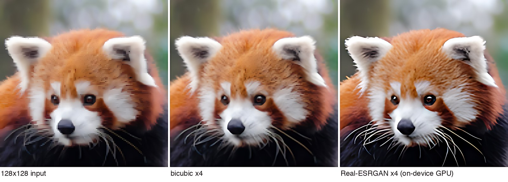

# MediaTek Dimensity 9500 (MT6993) NPU 逆向与部署笔记

在 **一台未 root 的零售 Android 手机上**，从零打通 MediaTek NPU 的 AOT 编译与推理执行链路，
并用它跑通 Real-ESRGAN 超分（相对 CPU **14.7×** 加速）。

设备：vivo V2548A / 天玑 9500 (MT6993) / Android 16 / 未 root / 全程在 Termux 内完成，**未使用 PC**。

---

## 核心结论

| 通道 | 是否可用 | 说明 |
|---|---|---|
| **NPU（AOT 预编译）** | ✅ **可用** | 本文的核心成果，卷积可跑 |
| NPU（设备端在线编译） | ❌ | 只开放 `ADD`/`MUL` 两个算子 |
| NNAPI | ❌ | 只暴露 CPU 参考实现 |
| GPU（Vulkan / OpenCL） | ✅ 可用 | **无需 root**，见 [无 root 调 GPU](docs/02-gpu.md) |

**关键认知：限制不在硬件，而在两条编译路径的开放程度不同。**

- 设备端把模型交给 NPU 现场编译（`NeuronCompilation_finish`）→ 被厂商裁剪到只剩逐元素算子
- 在 x86 上用官方工具链**离线预编译（AOT）** → 可以产出完整的卷积字节码，设备端能正常加载执行

---

## 关键数字

### NPU 推理性能（MobileNetV1，224×224）

| 模型 | 计算量 | NPU | CPU (XNNPACK 8T) | 加速 |
|---|---|---|---|---|
| MobileNetV1 0.25 | ~46 MFLOP | 0.97 ms | 0.89 ms | 0.9×（无优势） |
| MobileNetV1 1.0 | ~569 MFLOP | **1.40 ms** | 5.00 ms | **3.57×** |

小模型受 IO/同步开销支配，NPU 没有优势；计算量上来后才体现价值。

### Real-ESRGAN x4v3 超分（2364×1773 → 9456×7092）

| 执行方式 | 每块 128→512 | 整图 266 块 |
|---|---|---|
| **NPU** | **16.42 ms** | **4.37 秒** |
| CPU (XNNPACK) | 241.68 ms | 64.3 秒 |

**14.7× 加速。** 画质方面，纹理区锐度（拉普拉斯方差）从 9.11 提升到 **336.07（36.9×）**。



---

## 文档结构

| 文档 | 内容 |
|---|---|
| [01 · 平台探测](docs/01-platform.md) | 设备信息、SoC/GPU/NPU 识别、可用权限边界 |
| [02 · 无 root 调 GPU](docs/02-gpu.md) | **Vulkan/OpenCL/EGL 三条完整路径**、linker namespace 绕法、可复现代码 |
| [03 · NPU 访问分析](docs/03-npu-access.md) | NNAPI 与 Neuron SDK 直连，magic number 分级机制 |
| [04 · AOT 编译](docs/04-aot-compilation.md) | 在手机上自举 x86_64 工具链，跑通 LiteRT AOT |
| [05 · 设备端运行时](docs/05-device-runtime.md) | LiteRT Android 运行时 + dispatch 插件，`ACCEL=1` 的关键性 |
| [06 · 性能基准](docs/06-benchmarks.md) | 完整测量数据与调优过程 |
| [07 · 超分实战](docs/07-super-resolution.md) | 分块管线、画质对比、注意事项 |
| [08 · 附录](docs/08-appendix.md) | API 速查、踩坑清单、文件清单 |
| **[tools/](tools/)** | **可直接用的脚本与探测工具** |

---

## 附带工具

`tools/` 里有本次研究产出的可复用工具：

| 工具 | 用途 |
|---|---|
| `sr-gpu.sh` | GPU 超分封装（低干扰、模型预设、批量处理） |
| `sr_tile.py` + `sr_run.c` | NPU 分块超分管线 |
| `npu_run.c` | LiteRT NPU 运行器（计时 / 输出导出） |
| `probe_runtime.c` | 厂商运行时能力探测（magic / 版本 / 设备数） |
| `probe_op_support.c` | 算子支持度矩阵探测 |
| `neuron_add.c` | Neuron SDK 最小推理示例 |

详见 [tools/README.md](tools/README.md)。

## 复现路径（概要）

```bash
# 1. 自举 x86_64 环境（qemu + proot + glibc sysroot + standalone Python）
pkg install qemu-user-x86-64 proot

# 2. 装 LiteRT AOT 工具链
qemu-x86_64 -L sysroot ./python/bin/python3 -m pip install ai-edge-litert

# 3. 手动装配 MediaTek SDK（setup.py 只支持 linux x86 下载）
#    放到 site-packages/ai_edge_litert_sdk_mediatek/data/v9_0_3/host/lib/

# 4. AOT 编译
MTKNN_ADAPTER_DLA_PLATFORM=mt6993-a \
MTKNN_ADAPTER_COMPILER_OPTIONS="--num-mdla=4" \
qemu-x86_64 -L sysroot ./python/bin/python3 run_aot.py model.tflite out/

# 5. 设备端执行（从 Maven 取 arm64 运行时）
#    关键：accelerator 设为 CPU，NPU 由模型内嵌的 DISPATCH_OP 自动接管
LiteRtSetOptionsHardwareAccelerators(opts, 1 /* CPU */);
```

细节见各分册。

---

## 贡献

欢迎提 issue 讨论。特别欢迎这些方向的反馈：

- 其他 MTK 机型（尤其不同 NPU 代次）上是否同样可跑通 AOT
- 内部编译 flags 的进一步挖掘
- 量化模型（int8）在 NPU 上的实际吞吐

## 免责声明

本项目为个人研究记录。涉及的都是公开可获取的组件（LiteRT、MediaTek NeuroPilot SDK、
Maven 上的 LiteRT 运行时）。未修改任何系统文件、未使用 root、未破解任何加密。

`libneuronservice_adapter.mtk.so` 等厂商私有 ABI 可能随系统 OTA 变化，**不建议用于生产环境**。
