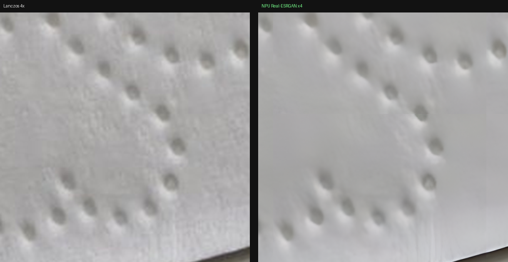
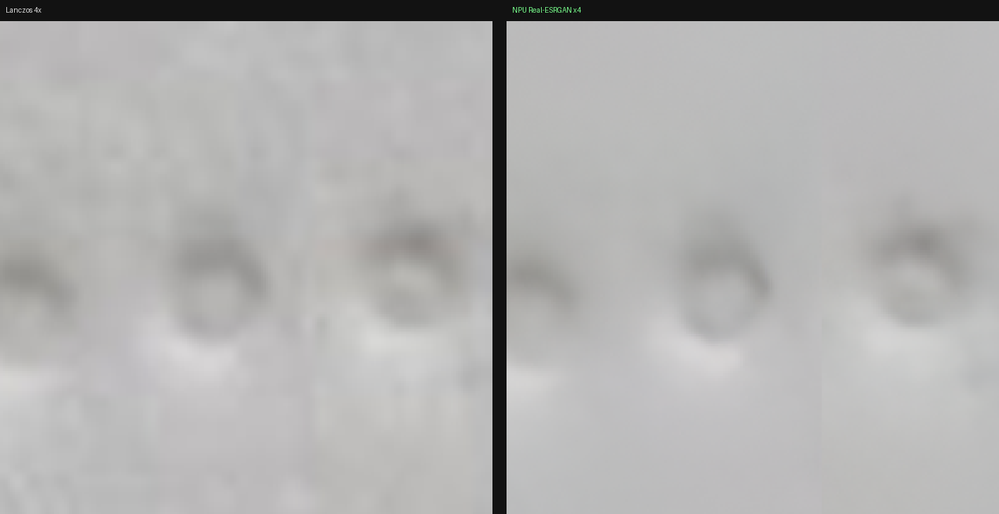

# 07 · 超分实战：Real-ESRGAN on NPU

把前面所有环节串起来，用真实照片跑一遍完整超分。

## 7.1 模型

`litert-community/real-esrgan-x4v3-litert`（HuggingFace，官方 LiteRT 转换版）

```
realesr_general_x4v3.tflite    3.4 MB
输入  [1, 128, 128, 3]  float32
输出  [1, 3, 512, 512]  float32    ← 注意是 NCHW
算子数 210
```

输入 NHWC、输出 NCHW 是个不对称设计，拼接时必须按通道优先处理。

AOT 编译（`--num-mdla=4`）耗时 **188 秒**，产物 3.5 MB。

## 7.2 为什么需要分块

模型输入固定 128×128。真实照片是 2364×1773，必须切块处理后拼接。

```
原图 2364×1773
  └─ 边缘复制补边到 128 的倍数 → 2432×1792
      └─ 切成 19×14 = 266 块 (每块 128×128)
          └─ NPU 逐块推理 → 266 个 512×512×3
              └─ 拼接 → 9728×7168
                  └─ 裁掉补边 → 9456×7092
```

## 7.3 管线实现

三个部分：

### 1) `sr_tile.py prep` —— 切块

```python
im = Image.open(src).convert("RGB")
# 边缘复制补边，避免黑边影响边缘块
pw, ph = (-W) % 128, (-H) % 128
im = Image.fromarray(np.pad(np.array(im), ((0, ph), (0, pw), (0, 0)), mode="edge"))

arr = np.asarray(im).astype(np.float32) / 255.0        # 归一化到 [0,1]
# 按行优先切成 128×128 块，写入 float32 二进制
```

### 2) `sr_run` —— 分块 NPU 推理（C）

流式处理，不把 266×3 MB 全放内存：

```c
for (int k = 0; k < count; k++) {
    fread(inbuf, 1, isz, fi);
    LiteRtLockTensorBuffer(ib, &addr, 1);
    memcpy(addr, inbuf, isz);
    LiteRtUnlockTensorBuffer(ib);

    LiteRtRunCompiledModel(cm, 0, 1, &ib, 1, &ob);

    LiteRtLockTensorBuffer(ob, &addr, 0);
    memcpy(outbuf, addr, osz);
    LiteRtUnlockTensorBuffer(ob);
    fwrite(outbuf, 1, osz, fo);
}
```

### 3) `sr_tile.py stitch` —— 拼接

**关键：输出是 NCHW，必须转置。**

```python
t = np.frombuffer(raw, dtype=np.float32).reshape(3, 512, 512)   # NCHW
t = np.transpose(t, (1, 2, 0))                                  # -> HWC
canvas[ty*512:(ty+1)*512, tx*512:(tx+1)*512] = t
```

最后裁掉补边、反归一化、保存。

## 7.4 结果

原图 2364×1773 → 输出 **9456×7092**（67 兆像素）。

| 执行方式 | 每块 | 整图 |
|---|---|---|
| NPU | 16.42 ms | **4.37 秒** |
| CPU | 241.68 ms | 64.3 秒 |

## 7.5 画质验证

自动选取原图中梯度最大的区域（纸张压纹）对比：

| 指标 | Lanczos 4× | NPU Real-ESRGAN 4× |
|---|---|---|
| 锐度（拉普拉斯方差） | 1.89 | **9.76（5.17×）** |



视觉差异：

- **Lanczos 4×**：压纹圆点糊成一团灰斑，纸张纤维和 JPEG 噪点被放大成一片斑驳
- **NPU SR**：圆点轮廓清晰、有明确高光和投影，纤维噪点被清理，纸张边缘锐利

### 一个需要注意的现象

在**本身就很平坦**的区域（例如大面积无纹理的纸面），NPU 输出比 Lanczos
**更平滑**（锐度 0.90 vs 1.03）。



这不是 bug。已验证 NPU 输出与 CPU 跑同一模型的数值差仅 0.0016，
所以这是 Real-ESRGAN x4v3 的模型特性：**它会去噪并抑制 JPEG 压缩伪影**，
在平坦区表现为「更干净」而不是「更锐利」。

评估超分效果时要按区域类型区分，不能只看单一指标。

## 7.6 使用

```bash
cd sr-npu
X=~/x86env
MODEL=$X/aot_sr/realesr_x4v3_MediaTek_MT6993_apply_plugin.tflite

# 1) 切块（可选裁剪 x,y,w,h）
python sr_tile.py prep input.jpg patches.bin meta.json

# 2) NPU 推理（块数 = nx*ny，见 meta.json）
ACCEL=1 LD_LIBRARY_PATH=$X/aar/libs ./sr_run $MODEL patches.bin out.bin 266

# 3) 拼接
python sr_tile.py stitch out.bin meta.json result.png
```

### 内存与磁盘

- 输入块数据：266 × 196608 B ≈ 52 MB
- 输出数据：266 × 3145728 B ≈ **798 MB**（流式写出，瞬时只占一块）
- 最终 PNG：约 42 MB

## 7.7 扩展到其他模型

替换模型时注意：

1. **输入尺寸**：改 `sr_tile.py` 里的 `TILE`，与模型输入保持一致
2. **输出布局**：NCHW / NHWC 要对应调整 `stitch()` 里的 reshape/transpose
3. **输出尺寸**：`SCALE` 要和模型实际放大倍数一致
4. **归一化**：本例是 `[0,1]`；有些模型要 `[-1,1]` 或 `[0,255]`
5. **色彩空间**：确认是 RGB 还是 BGR

上述任何一项不对，都会得到「看起来像但就是不对」的结果，
**建议每次都先用 CPU 跑同一模型做数值对照**（见 [06 · 基准](06-benchmarks.md)）。
